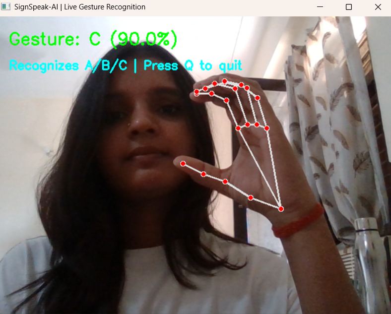
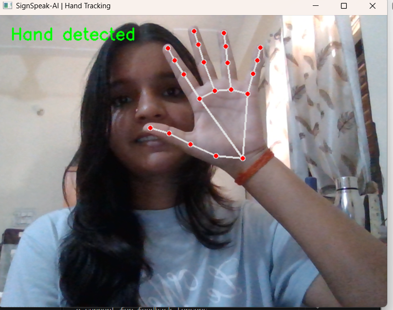

# SignSpeak-AI 

### Real-Time Hand Gesture Recognition Using Computer Vision & Deep Learning

**SignSpeak-AI** is a computer vision and deep learning project that recognizes selected static hand gestures through a webcam and converts recognized handshape predictions into text.

The application uses **MediaPipe** to extract hand landmarks, **OpenCV** for real-time webcam processing, and a **1D Convolutional Neural Network (CNN)** built with TensorFlow/Keras to classify gestures.

> An educational prototype exploring accessible human-computer interaction through real-time hand gesture recognition.

---

## 🎬 Project Demo

**Watch SignSpeak-AI in action:**

[▶️ Watch the Demo Video](screenshots/Demo%20Video.mp4)

### Application Screenshots

**Live Gesture Recognition**



**Hand Tracking and Landmark Detection**



---

## ✨ Key Features

- **Real-Time Webcam Processing:** Captures live video using OpenCV.
- **Hand Landmark Detection:** Detects and tracks 21 hand landmarks using MediaPipe.
- **Feature Extraction:** Converts landmark coordinates into 63 numerical features.
- **Deep Learning Classification:** Uses a trained 1D CNN to classify supported static handshapes.
- **Live Predictions:** Displays predicted gestures and confidence information.
- **Top-Three Predictions:** Displays candidate classes to help inspect model output.
- **Letter-to-Text Interaction:** Allows recognized letters to be combined into text.
- **Text Editing:** Supports inserting spaces, deleting characters, and clearing text.
- **Text-to-Speech:** Provides a keyboard shortcut to speak the current text.
- **Model Evaluation:** Includes evaluation reports and confusion matrices.

---

## 🧠 How It Works

The application follows this pipeline:

```text
        Webcam Input
             |
             v
   Hand Detection and Tracking
             |
             v
    MediaPipe Hand Landmarks
             |
             v
  21 Landmarks (x, y, z)
             |
             v
    63 Numerical Features
             |
             v
       Normalization
             |
             v
      Trained 1D CNN
             |
             v
     Gesture Prediction
             |
             v
      Letter-to-Text
             |
             v
    Recognized Text / Speech
```

### Technical Workflow

1. **Capture:** OpenCV captures frames from the webcam.
2. **Detect:** MediaPipe detects the hand and extracts 21 landmarks.
3. **Extract:** The landmark coordinates form a 63-feature input vector.
4. **Normalize:** Features are normalized using the statistics saved for the trained model.
5. **Predict:** The CNN predicts one of the supported gesture classes.
6. **Display:** The predicted gesture and confidence information appear in the application.
7. **Interact:** Keyboard controls allow users to build and edit text and use text-to-speech.

---

## 📊 Dataset and Model Performance

The current CNN evaluation report contains the following results:

| Metric | Result |
|---|---:|
| Total dataset samples | 3,191 |
| Input features per sample | 63 |
| Supported gesture classes | 10 |
| Training samples | 2,235 |
| Validation samples | 318 |
| Test samples | 638 |
| **CNN test accuracy** | **92.63%** |
| Test loss | 0.254219 |

### Supported Gesture Classes

`A` · `B` · `C` · `D` · `E` · `F` · `G` · `H` · `I` · `K`

The current model recognizes these selected static handshapes. It does not support all alphabet letters or complete sign-language translation.

### Evaluation Methodology

The dataset is split into training, validation, and test sets using stratification by class label. Normalization statistics are calculated from the training data.

**Important limitation:** The split is not grouped by recording session. Samples from the same recording session may appear in multiple subsets, potentially overestimating performance on unseen recordings or users. Independent-session and unseen-user evaluation is needed to assess real-world generalization.

The reported accuracy applies to the current evaluation dataset and should not be interpreted as a guarantee of real-world accuracy.

---

## 🛠 Technology Stack

| Technology | Purpose |
|---|---|
| Python | Application logic and ML workflow |
| OpenCV | Webcam capture and image display |
| MediaPipe | Hand detection and landmark extraction |
| NumPy | Numerical processing |
| TensorFlow / Keras | CNN training and inference |
| scikit-learn | Machine learning utilities and evaluation |
| Joblib | Saving and loading the Random Forest model |

---

## 📁 Project Structure

```text
SignSpeak-AI/
├── data/
│   └── raw/
│       └── landmarks.csv
├── models/
│   ├── gesture_model.joblib
│   ├── gesture_cnn.keras
│   ├── gesture_cnn_classes.json
│   └── hand_landmarker.task
├── reports/
│   ├── cnn_confusion_matrix.csv
│   ├── cnn_evaluation_report.json
│   ├── confusion_matrix.csv
│   └── evaluation_report.json
├── screenshots/
│   ├── hand-tracking.png
│   ├── live-gesture-recognition.png
│   └── Demo Video.mp4
├── src/
│   ├── collect_data.py
│   ├── predict_live.py
│   ├── train_model.py
│   └── train_cnn.py
├── .gitignore
├── LICENSE
├── README.md
└── requirements.txt
```

*This structure represents the intended project layout. Confirm that each listed file exists in your repository before publishing.*

---

## ⚙️ Installation and Setup

### Prerequisites

- Python version compatible with the project's installed dependencies
- Git
- A working webcam
- A compatible operating system and Python environment

### 1. Clone the Repository

```bash
git clone https://github.com/sikha890/SignSpeak-AI.git
cd SignSpeak-AI
```

### 2. Create and Activate a Virtual Environment

**Windows — PowerShell**

```powershell
python -m venv .venv
.\.venv\Scripts\Activate.ps1
```

**Windows — Git Bash**

```bash
python -m venv .venv
source .venv/Scripts/activate
```

**macOS / Linux**

```bash
python3 -m venv .venv
source .venv/bin/activate
```

### 3. Install Dependencies

```bash
python -m pip install --upgrade pip
pip install -r requirements.txt
```

Ensure `requirements.txt` contains the dependencies needed by the current CNN application, including compatible versions of TensorFlow, MediaPipe, OpenCV, and NumPy.

### 4. Run Live Gesture Recognition

From the project root, run:

```bash
python src/predict_live.py
```

The application should load the trained model, initialize the webcam, detect hand landmarks, and display gesture predictions.

**Troubleshooting:** If the application cannot find a model or landmark file, verify that the required files exist in `models/` and that the paths configured in the Python scripts match the repository structure.

---

## ⌨️ Keyboard Controls

Use these controls while the application window is focused:

| Key | Action |
|---|---|
| `Space` | Insert a space into the text buffer |
| `Backspace` | Delete the last character |
| `C` | Clear the current text |
| `T` | Speak the current text |
| `Q` | Quit the application |

---

## ⚠️ Scope and Limitations

- The current model supports 10 selected static handshape classes.
- It does not recognize all 26 alphabet letters.
- It is not a complete sign-language translation system.
- Dynamic signs involving movement are not currently covered by the stated model scope.
- Recognition can vary with lighting, camera quality, hand orientation, background conditions, and the person performing the gesture.
- The reported test accuracy has not been validated using a recording-session-independent split.
- Text output depends on the predictions and how consistently gestures are presented.

---

## 🚀 Future Improvements

- Expand the number and diversity of supported gesture classes.
- Collect more balanced training data across users and recording conditions.
- Evaluate performance on independent recording sessions and unseen users.
- Improve prediction stability and confidence calibration.
- Develop dynamic gesture recognition for movement-based signs.
- Explore sentence-level sign-language understanding and translation.
- Improve interface accessibility and usability.

---

## 📄 License

This project is licensed under the MIT License. See [LICENSE](LICENSE) for details.

---

## 👩‍💻 Author

**Sikha Kumari**

GitHub: [@sikha890](https://github.com/sikha890)

---

*SignSpeak-AI is an educational computer vision and deep learning prototype focused on static hand gesture recognition and letter-to-text interaction.*
